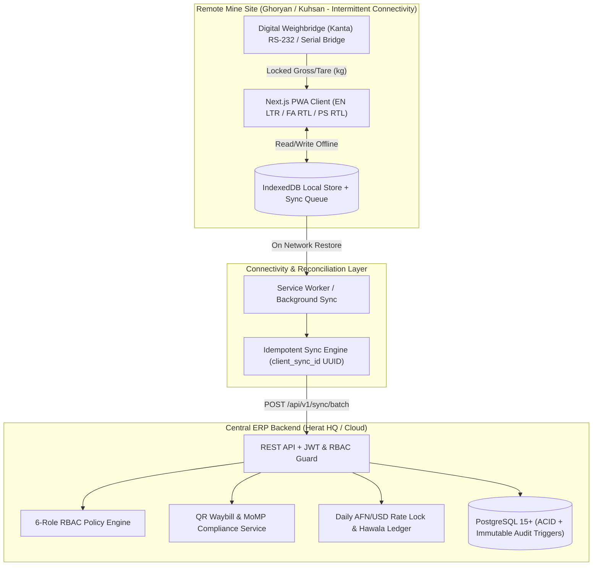
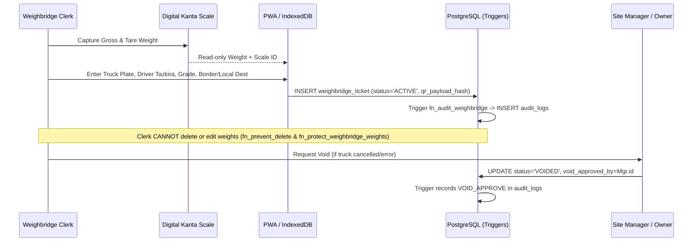

# System Architecture & Data Flow — Herat Salt Mine ERP

## 1. High-Level Architecture (Offline-First & Anti-Fraud)

## 2. Offline-First Sync & Reconciliation Flow

1. **Client-Side UUID Generation:** Every field entry (`weighbridge_tickets`, `extraction_logs`) is assigned a deterministic `client_sync_id` (UUID v4) and `offline_created_at` timestamp at creation time.
2. **IndexedDB Persistence:** When `navigator.onLine === false` (or when the user toggles Site Offline Mode), records are committed immediately to IndexedDB (`pending_sync_queue`) and rendered in the UI with a `PENDING_SYNC` badge.
3. **Idempotent Batch Reconciliation:** Upon reconnection, the Sync Engine posts queued records to `/api/v1/sync/batch`. PostgreSQL uses `ON CONFLICT (client_sync_id) DO NOTHING` to guarantee zero duplicate tickets or extraction tonnage.
4. **Server Timestamping:** The server records `synced_at = NOW()` while preserving `offline_created_at` for accurate shift/daily reporting.

## 3. Anti-Fraud Weighbridge (Kanta) Flow

## 4. Role-Based Access Control (RBAC) Matrix

| Module / Capability | Mine Owner | Site Ops Mgr | Weighbridge Clerk | Warehouse Officer | Finance Officer | HSE Officer |
| :--- | :---: | :---: | :---: | :---: | :---: | :---: |
| Executive KPIs & Profit/Loss | Full | Production Only | No | No | Full | HSE Only |
| Extraction Logs & Fleet | View | Full | No | View | View | View |
| Weighbridge Tickets | View + Void Approve | View + Void Approve | Create + Print QR | View | View (Invoicing) | No |
| Warehouse & Processing | View | Full | No | Full | View | No |
| Sales, Hawala & MoMP Royalties | Full | No | No | No | Full | No |
| HSE Incidents & Compliance | Full | View | No | No | No | Full |
